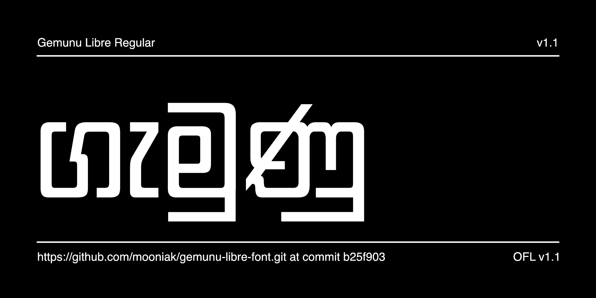
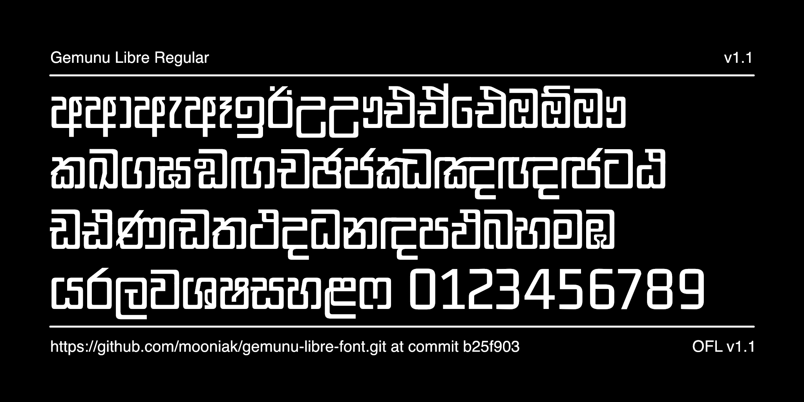

ගැමුණු ලිබ්රේ අකුරු මුහුණත / Gemunu Libre Font
===================

[![Build][badge-build]][link-build]
[![Fontspector QA][badge-qa]][link-qa]
[![Release][badge-release]][link-release]
[![License: OFL 1.1][badge-license]][link-license]

[badge-build]: https://github.com/mooniak/gemunu-libre-font/actions/workflows/build.yaml/badge.svg?branch=dev
[badge-qa]: https://img.shields.io/badge/dynamic/json?url=https%3A%2F%2Fsrc.mooniak.com%2Fgemunu-libre-font%2Fbuild.json&query=%24.qa.pass_rate&suffix=%25&label=fontspector%20QA%20(dev%20build)&color=informational
[badge-release]: https://img.shields.io/github/v/release/mooniak/gemunu-libre-font?label=release
[badge-license]: https://img.shields.io/badge/license-OFL--1.1-green
[link-build]: https://github.com/mooniak/gemunu-libre-font/actions/workflows/build.yaml
[link-qa]: https://src.mooniak.com/gemunu-libre-font/reports/fontspector/fontspector-report.html
[link-release]: https://github.com/mooniak/gemunu-libre-font/releases
[link-license]: OFL.txt

Gemunu Libre is the Unicode-compliant revival of the Sinhala typeface FM Gemunu by Pushpananda Ekanayake, with a matching Latin by Sol Matas. It has a squarish but smooth design and comes in seven weights from Extra Light to Extra Bold, each with the complete Sinhala script and Latin. It is led by [Mooniak](https://mooniak.com/) and published as a free font under the SIL Open Font License.

සිංහල අකුරු ඉතා රවුම් හැඩ ගනී. ඒවායෙහි කෙළින් ඉරි සහිත ස්වභාවය ඉතා අඩු ය. හැම ඉරක්ම කුමන හෝ වක්‍ර ස්වභාවයක් සහිත ය. පැරණි පුස්කොළවල ලියා ඇති සිංහල අකුරු පවා මනා රවුම් ලක්ෂණ පළ කරයි.එෆ් එම් ගැමුණු’ මෝස්තරය මීට හාත්පසින්ම වෙනස් ය. එය තනිකරම හතරැස් හැඩ සහිත අකුරු මෝස්තරයකි. බිංදුව පවා හතරැස් ය. කිසිදු රවුම් අකුරක් එහි නැත. ගැමුණු ලිබ්රේ අකුරු මුහුණත එෆ් එම් ගැමුණු මුහුණතේ යුනිකේත අනුකූල නිදහස් හා නොමිලේ ලබාදෙන නිකුතුවයි. මෙය නව web font තාක්ෂණය හරහා ඕනෑම වෙබ් අඩවියක හෝ යෙදුමක භාවිතා කරන්නට හැකි ලෙස සකස් කර ඇති අතර, නව පහ අන්තර 6 කින් (ExtraLight, Light, Regular, Medium, SemiBold, Bold, ExtraBold) සමන්විතය. මෙය ගැමුණු සඳහාම නිර්මාණය වන ලතින් හෝඩියේ අක්ෂරද සමග එළිදැක්වා ඇත.

Gemunu Libre is the Unicode compliant version of the popular Sinhala typeface ‘FM Gemunu’ by Pushpananda Ekanayake. With its squarish, but smooth design, Gemunu Libre has a distinctive personality among all the other Sinhala typefaces that are currently in use.

Gemunu Libre has improved in many ways than its former design (FM Gemunu) in the Unicode adaptation process; acquiring more breathing space, bigger counters and uniformity in curves. The character set was completely redrawn to suit the usage on web and screen.
Gemunu Libre comes in 7 weights from Extra Light to Extra Bold. Each weight contains the complete Sinhala script and a matching Latin character set designed by Sol Matas.

The project was funded by Google Fonts project and led by Mooniak, a collaborative collective of designers based in Colombo Sri Lanka with the cooperation of Mr. Pushpananda Ekanayake, the designer  of the FM Gemunu font and Sol Matas as the Latin designer.For Mooniak, Kosala Senvirathne, Pathum Egodawatta and Ayantha Randika contributed to the project in consulting, managing and Opentype engineering.

Mooniak welcomes new contributions, expansion to Tamil, suggestions and improvements. Please see the [github repository](https://github.com/mooniak/gemunu-libre-font/milestones) for  pending updates and  further development plans, pending updates. See the web specimen page here. See /documentation for notes information on the development of the project.

See the web specimen page [here](http://mooniak.com/gemunu-libre-font/).
See [/documentation](https://github.com/mooniak/agemunu-libre-font/tree/master/documentation) for notes information on the development of the project.
Report any issues or bugs in [issues](https://github.com/mooniak/gemunu-libre-font/issues/new).

## Repository Structure

This repo is the active devleopment repo of the project. So files move here and the sometimes. See [live testing page](http://mooniak.com/gemunu-libre-font/tests/) to see work in progress.

- See [Releases](https://github.com/mooniak/gemunu-libre-font/releases) to Download released clean font versions, sources and specimens at the release point.

- `/sources/` contains dirty and incomplete `.ufo` files which opens in all major font editors. These files are generated in intervals in between development. See [Releases](https://github.com/mooniak/gemunu-libre-font/releases) for clean sources.

- See `/documentation` for screenshots, correspondence and testing documents.

## How To Build
TODO

## Credits

See FONTLOG.md for details on contributions.

- Pushpanada Ekanayake (@pushpananda)
- Sol Matas (@solmatas)
- Kosala Senevirathne (@kosalaya) of mooniak
- Ayantha Randika (@paarandika) of mooniak
- Pathum Egodawatta (@pathumego) of mooniak

## License

Gemunu Libre is released under the  [SIL Open Font License](http://scripts.sil.org/OFL)

For information on what you're allowed to change or modify, consult the
OFL.txt and OFL-FAQ.txt files. The OFL-FAQ also gives a very general
rationale and various recommendations regarding why you would want to
contribute to the project or make your own version of the font.
